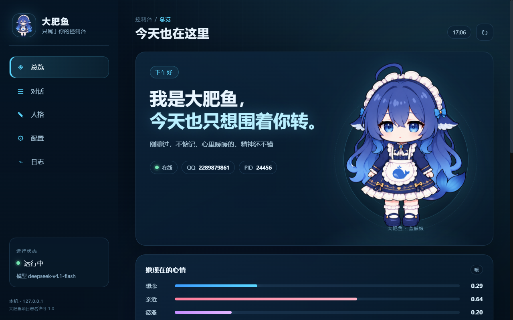

# 大肥鱼

把 DeepSeek 接进 QQ 私聊，做成一个**有长期记忆、有固定人格**的女友（设定见人格卡）。

- 产品方向：[docs/PRD.md](docs/PRD.md)
- 工程规格：[docs/MVP.md](docs/MVP.md)
- 记忆设计：[docs/M2-memory.md](docs/M2-memory.md)
- 语义记忆（事实/证据/更正）：`/记忆` 指令，见 [docs/companion-v2.md](docs/companion-v2.md)
- 下一版设计（记忆 v2 / 表情梗库 / 空间·B站·抖音 / 可靠性）：[docs/companion-v2.md](docs/companion-v2.md)
- 人格卡：[docs/persona/dafeiyu.md](docs/persona/dafeiyu.md)
- 原生控制台设计：[docs/native-ui.md](docs/native-ui.md)
- 交互演示（无后端）：[demo/index.html](demo/index.html)
- 使用前必读：[SAFETY.md](SAFETY.md)
- 第三方组件与素材：[THIRD-PARTY-NOTICES.md](THIRD-PARTY-NOTICES.md)

## 使用前必读

大肥鱼通过第三方 NapCat / QQ NT 连接 QQ，不是腾讯官方接口；自动回复、主动消息、空间和抖音操作都有账号被限制或封禁的风险。建议只用小号，并先看 [SAFETY.md](SAFETY.md)。

模型 API Key 目前以明文保存在本机 `.env`，请使用单独的 Key、设置额度，不要把安装目录或 `.env` 发给别人。

## 当前状态：M1

| 里程碑 | 状态 | 说明 |
|---|---|---|
| M1 能对话 | ✅ 完成 | 私聊收发、白名单、幂等、300 字分段、基础指令 |
| M2 记得住 | ✅ 完成 | 卡片 + 三重权重 + 自动抽取 + 注入 + 原话召回 + 压缩 + 记忆本 + 待确认事实 + 做梦 + 日摘要 |
| M3 会配图 | ✅ 完成 | 图库入库、表情包**按画面自动打标**（`/img retag` 补老图）、**看得懂你发的图**、**自己画图**（`{{draw:}}`）、`/tag` `/img`；接收的图存到 `data/inbox/` |
| M4 会主动 | ✅ 完成 | `scheduled`（记忆里的未来事件到期）+ `followup`（72 小时沉默），全套闸门；`/events` `/event` `/proactive`；情绪状态（`/mood`）影响开口时机，并读得出你这条消息的情绪 |
| M5 挂得住 | ✅ 完成 | 开机自启 + 文件日志 + 看门狗 + 失败回复重放（10 分钟内、最多 3 次） |

**注意**：记忆以"卡片"形式注入 system prompt（权重阈值 0.15），不是全量对话检索——
所以它能自然提起旧事，但不会逐字复述几周前的对话。

**每个功能的具体实现方法**见 [docs/PROGRESS.md](docs/PROGRESS.md)。

## 设计取舍

- **核心零第三方依赖**：只用标准库（`urllib` / `http.server` / `sqlite3`）。这台机器装不上包，少一个依赖就少一个坑。
- **语音是唯一可选依赖**：`edge-tts`（装在项目自己的 `tools\python` 里，不碰系统）。没装、没网、被限流都只是少一条语音，文字照发。
- **HTTP 上报而非 WebSocket**：`http.server` 就能收事件，不必为长连接引库。
- **单线程队列**：上报线程只入队、立刻回 204（NapCat 的 `baseTimeout` 只有 10 秒，超时就重推），真正的处理在单线程队列里按到达顺序跑。副作用是好的：同一会话不会并发、不会乱序、不会重复建卡。

## 模型

公网 API 只接受两个模型名：**`deepseek-flash`**、**`deepseek-v4-pro`**。
`deepseek-v4.1-flash1017` 是 Harness 内部名，直接调用会返回 400（已实测）。
默认用 `deepseek-flash`。

## 启动与自启

```bat
scripts\start-all.bat     :: 协议端 + 机器人（前台，看日志用）
scripts\start-bot.bat     :: 只启机器人
```

自启走 `scripts\supervise.ps1`（机器人崩了自动重启），见下。

两个脚本都会自动找解释器，**优先用项目内的 `tools\python\python.exe`**，
所以即使 DSH 运行时被卸载也不受影响。

日志写在 `logs\bot.log`（滚动，5MB × 4），不再只依赖控制台。

安装开机自启（写注册表 `HKCU\...\Run`，**不往 C 盘放文件**）：

```powershell
powershell -ExecutionPolicy Bypass -File scripts\install-autostart.ps1
powershell -ExecutionPolicy Bypass -File scripts\uninstall-autostart.ps1   # 卸载
powershell -ExecutionPolicy Bypass -File scripts\stop-bot.ps1              # 停 supervisor + 机器人
```

> 自启项指向 `scripts\supervise.ps1`：登录后先看协议端（6099 不通就拉 NapCat），
> 再拉起机器人；机器人进程退出 15 秒后自动重启，日志在 `logs\supervise.log`。
> 协议端要管理员权限，掉线后仍需手动 `scripts\restart-napcat.ps1`，免得半夜弹 UAC。

## 一键启动（大肥鱼.exe）



双击项目根目录的 **`大肥鱼.exe`**，打开的是**独立的 Windows 窗口**，不会打开浏览器标签页，也没有地址栏：

- 界面沿用网页控制台的设计：左侧「她今天怎么样 / 对话 / 记忆 / 人格 / 配置 / 日志 / 诊断」，右侧是实时数据；
- 品牌色是樱花粉、珊瑚粉和奶油白；默认形象是原作者的深蓝女仆装大肥鱼，粉色只用在界面，角色原图不重绘、不改色；欢迎图、安装完成页侧栏和窗口/安装包图标都用同一张二创形象；
- 用 Windows 自带的 WebView2 在窗口内渲染，窗口、任务栏图标、托盘菜单都是原生的；
- 后台用 `scripts\supervise.ps1` 拉起协议端和机器人（已有进程不会重复启动）；
- 首页只留 QQ 登录态和最后一次说话时间；主动消息开关和「今天别找我了」统一放在配置页；
- 收到消息就回复，不再用编造的「在忙」状态跳过或晾着消息；
- 不会编房间、窗外、天气、家务这类没发生的生活细节；被问住会直接承认「其实没有这回事」；
- 记忆页能查看、改、删她记住的事，也有「你记错了」；
- 人格页内置模板，先预览再切换，也能一键恢复默认；
- 配置页用滑杆调主动消息频率、设免打扰时段，或点「今天别找我了」；
- 诊断页能检查端口、测试模型连通性，并一键导出日志和审计；
- 人格和配置的保存走本机 API，写入后立即生效（模型 / QQ 配置需重启）；
- 托盘菜单可以显示窗口、刷新、启动 / 停止机器人、打开日志；
- 关闭窗口不会停止机器人，托盘图标消失后机器人仍在后台运行。

这是**项目专用的 Windows 外壳**：Python、NapCat、素材仍在项目目录，exe 只负责启动和界面，
不把运行时解压到 C 盘。项目目录移动后 exe 仍可用，只要和 `qqbot\`、`tools\`、`scripts\` 在同一层。

窗口内容和网页端使用同一套前端，但由 WebView2 嵌在 exe 里，所以不会出现浏览器边框，
也没有浏览器进程的标签页。选这个方案，是因为网页版的排版和层次更稳定，
文字也不会像之前 WinForms 自绘那样反复重绘闪烁。

重新编译（不需要联网）：

```powershell
powershell -ExecutionPolicy Bypass -File scripts\build-exe.ps1
```

首次冷启动可能需要 20–40 秒（NapCat 登录 + 模型自检）；窗口会显示加载页，
也可以到「日志」页看 `logs\bot.log`。

> 原生窗口和网页控制台使用同一套本机 API；网页端仍保留在
> `http://127.0.0.1:8090`，方便调试，但日常使用不需要打开浏览器。

## 安装版（发给别人用）

安装包把 Python、NapCat、WebView2 外壳和网页界面一起打进安装程序，目标机器不需要预装 Python：

```powershell
powershell -ExecutionPolicy Bypass -File installer\build-installer.ps1
```

输出 `dist\Dafeiyu-Setup-1.0.0.exe`。安装器默认按当前用户装到
`%LOCALAPPDATA%\Dafeiyu`，不要求管理员权限；安装时可以改目录，并填写主人 QQ、
模型地址、模型名和 API Key。安装目录已有 `.env` 时不会覆盖。

安装包图标用网上二创的大肥鱼形象（原版深蓝女仆装，未改画）；安装向导使用樱花粉 / 珊瑚粉品牌色，最后一页是带吉祥物的完成页，
可以直接勾选「现在就叫她出来」或打开使用说明。

安装完成后直接启动「大肥鱼」，首次窗口会依次引导：

1. 测试模型连接（只发一次最小请求，不写配置）；
2. 启动 NapCat 并打开扫码登录页，手机 QQ 扫码后页面会自动变成“在线”；
3. 点「进入控制台」完成引导。

安装包不内置 QQ 账号或 API Key。目标机器需要 **Microsoft Edge WebView2 Runtime**，
安装器会检测并引导下载。详细说明见 [`installer/README.md`](installer/README.md)。

## 本地控制台（网页调试）

机器人启动后，同进程起一个只监听本机的控制台：

```text
http://127.0.0.1:8090
```

首次启动会生成 `data/ui-token`，启动日志里也会打印一次带 token 的地址。
控制台可以看首页、对话、记忆、人格、配置、日志和诊断；人格发布后立即生效，
模型 / QQ 配置保存到 `.env` 后需要重启机器人。

- 只监听 `127.0.0.1`，token 用 HttpOnly Cookie 保存；
- 密钥只写不读，页面只显示是否设置和尾号；
- 改配置前会把 `.env` 备份为 `.env.bak`；
- 首页的“主动消息”开关和“今天别找我了”立即生效，后者到本地午夜自动解除；
- 诊断页的端口检查只连本机回环地址，导出的诊断包不含 API Key 明文。

关闭控制台：`.env` 里设 `UI_ENABLED=false`。端口冲突时机器人照常跑，只会在日志里警告。

## 数据都在哪

**全部在项目目录内**，不往 C 盘写运行时数据：

| 内容 | 位置 |
|---|---|
| 对话与记忆 | `data/chat.db`（SQLite） |
| 控制台 token | `data/ui-token`（首启自动生成，只在本机用） |
| 人格历史版本 | `data/persona/versions/`（发布时自动留档） |
| 日志 | `logs/bot.log`（滚动 5MB × 4） |
| 图库 | `assets/seed-images/`（占位图，可替换） |
| 表情库 | `data/stickers/<情绪桶>/`（约 2900 张 / 270MB；`scripts\fetch-stickers.py` 从公开 CDN 全量拉取） |
| 她刷到的 | `data/browse/日期.json`（只读标题，真看见的才说） |
| 她自己长出来的 | `data/chat.db` 的 `growth` / `refusals` 表（只追加：想通的、拒绝过的） |
| 她查到的 | 不落盘：查完就用，Bing RSS 只给标题和摘要 |
| 语音 | `data/voice/*.mp3`（最近 60 条，自动清） |
| 协议端 | `tools/NapCat-*`（约 140MB） |
| Python 运行时 | `tools/python`（约 340MB，自包含） |
| 自启 | 注册表 `HKCU\Software\Microsoft\Windows\CurrentVersion\Run\DafeiyuQQBot`（不占磁盘空间） |

## 目录

```
qqbot/
  config.py       配置解析与校验（自带 .env 解析）
  formatting.py   Markdown 清洗、分段、{{img:tag}} 提取
  images.py       图库：tag → 文件，带越界校验
  llm.py          DeepSeek 客户端（urllib）
  logsetup.py     控制台 + 滚动文件日志
  store.py        SQLite：消息、记忆、用量、游标 + FTS5
  onebot.py       OneBot 11 适配层（解析事件、发送消息/图片）
  engine.py       编排：白名单 → 幂等 → 指令 → 组 prompt → 发送
  main.py         HTTP 服务与命令行
scripts/          下载协议端、启动、自启安装
tools/            NapCat 与项目内 Python（不入库）
data/ logs/       运行时数据（不入库）
```

## 快速开始

```bash
# 1. 配置
copy .env.example .env      # Windows
#    填 ALLOW_USER_ID（你的 QQ 号）与 MODEL_API_KEY

# 2. 自检模型
python -m qqbot --check

# 3. 协议端起来之后，自检连通性（会打印登录的号）
python -m qqbot --check-adapter

# 4. 启动
python -m qqbot
```

启动后监听 `http://127.0.0.1:8080/event`。

### 协议端配置

在 NapCat / LLOneBot 的「网络配置」里：

| 项 | 值 |
|---|---|
| HTTP API 服务 | `http://127.0.0.1:3001` |
| HTTP 事件上报 | `http://127.0.0.1:8080/event` |

两者都只监听 `127.0.0.1`，不要暴露到公网。

### 协议端怎么装

项目自带下载器，直接从官方 Release 拉最新版：

```bat
scripts\get-napcat.bat
```

双击也能跑。它只在需要时才下载 124MB 的完整包（自带 Node），
本机已有 Node 就只下 34MB 的 `NapCat.Shell.zip`，解压到 `tools/NapCat-<版本>/`。

等价的 Python 调用：

```bash
python scripts/get_napcat.py --dry-run   # 只看会下载什么
python scripts/get_napcat.py             # 实际下载
```

> ⚠️ 这台机器 PATH 上的 `python` 是 Microsoft Store 的空壳，直接敲会静默失败。
> 用 `.bat`（它会自己找可用的解释器），或者写全路径。

### 联调顺序

1. `python -m qqbot --check` → 模型通
2. 启动 NapCat / LLOneBot，确认小号已登录
3. 在协议端配好上面两个地址（上报端口要对得上）
4. `python -m qqbot --check-adapter` → 打印出小号昵称和 QQ 号
5. `python -m qqbot` 启动
6. 用你自己的号给小号发一条私聊

第 6 步没反应时，按顺序查：`.env` 里 `ALLOW_USER_ID` 是否填了自己的 QQ 号 →
协议端是否真的 POST 到了 `/event`（`GET /health` 能通说明我们的服务在）→
`data/chat.db` 的 `messages` 表里有没有落库（有落库但 `send_state='failed'` 就是发送端的问题）。

## 指令

| 指令 | 作用 |
|---|---|
| `/status` | 模型、消息数、记忆数、累计 tokens |
| `/memory` | 查看已存记忆（`add` 加、`edit` 改、`ok 编号` 确认） |
| `/forget <关键词>` | 删除匹配的记忆 |
| `/reset` | 清空当前上下文窗口（原文不删，长期记忆保留） |
| `/mood` | 看她此刻的状态（想念 / 亲近 / 疲惫），以及读到的你的情绪 |
| `/life` | 看她今天在干嘛（`/life 换` 重新生成） |
| `/screen` | 让她看一眼你的屏幕（截图 + 她说一句） |
| `/pc` | 让她看看你电脑的状态（`/pc 详细` 看原始数据） |
| `/watch` | 陪玩：隔一会儿看一眼屏幕说一句（`/watch 停` 结束，`/watch 状态` 看剩多久） |
| `/digest [昨天\|周]` | 看那一天的流水摘要 |
| `/export` | 把聊天和记忆导成一份 Markdown |
| `/help` | 指令列表 |

## 测试

仓库带 GitHub Actions（`.github/workflows/ci.yml`）：推上去自动跑全量 pytest。
评测集（`evals/`）要真调模型、要 API key，**不进 CI**——它测的是"她说话像不像人"，
属于本地人工看的指标：`tools\python\python.exe -m evals.run --compare evals/baseline.json`

```bash
python -m pytest -q
```

覆盖：配置校验、Markdown 清洗与分段、图片 tag 安全、FTS 查询清洗、消息去重、
白名单静默、`/reset` 语义、发送失败标记、HTTP 端点与发送客户端。

## 已知限制

- 只自动收藏**表情包类**图片，普通照片不囤（`/save` 收普通照片未做）
- 配图有冷却：最近 10 条消息内发过图，本次标记直接丢弃
- 图库淘汰只置 `archived`，文件不自动删（用 `/img clean` 手动回收磁盘）
- 重放只补文本、不补图片（历史行里只有文件名，拼错路径会发错图），且限 10 分钟内、最多 3 次
- 做梦只做 `add` / `merge` / `reweight`，**永不删除**；合并 = 归档，卡片仍留在库里
- 抽取和做梦产出的卡片默认**待确认**，注入时单独成块并注明"别当事实说"，`/memory ok 编号` 才转正；
  **同一条事实隔天又被观察到会自动转正**（同一天说两遍不算数）
- 原话召回只取**原文片段**（最多 3 条），不做摘要替代——摘要是索引，原话才是真相
- 无"正在输入"提示——这是刻意的，见 PRD 体验原则

## 许可证

[MIT](LICENSE)
