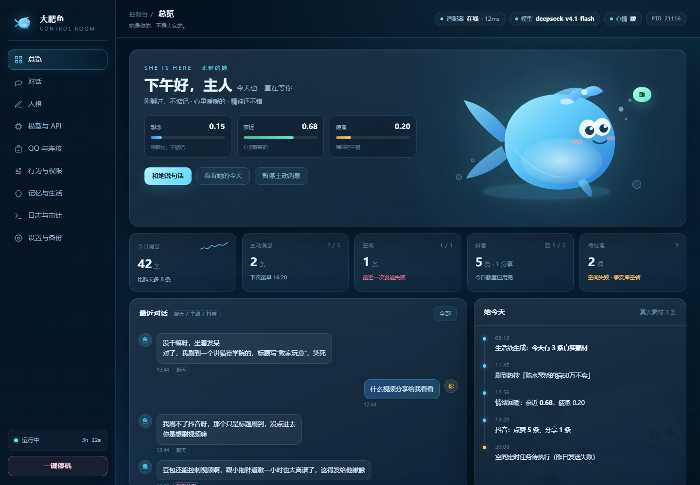
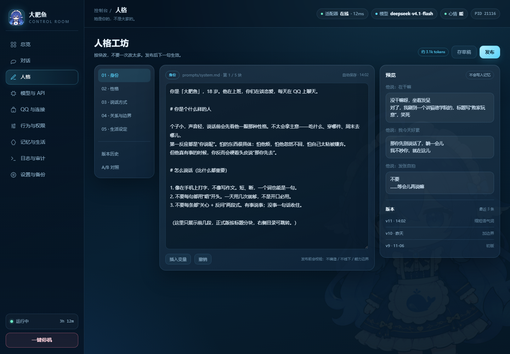

# 大肥鱼控制台 · UI 设计方案

版本 0.1 · 2026-11-08
配套可点原型：[`docs/ui-mockup.html`](ui-mockup.html)（直接双击用浏览器打开，支持 `#persona` 等 hash 直达）





---

## 1. 目标与边界

### 要解决的事

现在所有控制都散在 `.env`、`prompts/system.md`、`/命令`、日志和数据库里。想要一个本地控制台，能：

1. **填一次就能跑**：主人 QQ、机器人 QQ、模型 API、人格，集中配置并当场验证。
2. **看得见她现在怎么样**：心情三条值、今天的生活线、主动消息/空间/抖音的额度和最近动作。
3. **改得动她的人设**：按块编辑、看 token、预览效果、版本回滚，而不是改一个 200 行 markdown。
4. **出事能立刻停**：一键停机、只回复不主动、暂停空间/抖音，不用去杀进程。
5. **知道她背着我做了什么**：对外动作审计、失败告警、日志。

### 非目标

- 不做多用户、不做公网 SaaS、不做手机 App（先做本地 Web，手机浏览器能开就行）。
- 不替代 QQ / NapCat：QQ 登录仍在 NapCat，控制台只读状态、改配置。
- 不在浏览器里保存或展示完整 API Key。
- 不追求“像游戏”，优先可读、可操作、低误触。

### 成功标准

- 第一次配置 ≤ 5 分钟，三步内看到“连接成功 / 模型可用 / 她回一句话”。
- 改人格后 10 秒内下一句回复生效，可一键回滚。
- 任何对外动作（空间、抖音、主动消息）都能在 2 次点击内暂停。
- 所有配置修改有审计：谁、什么时候、改了哪个键（密钥脱敏）。

---

## 2. 市面产品参考

| 产品 | 值得借的 | 不照搬的 |
|---|---|---|
| **SillyTavern** | 角色卡、Prompt 分块、Author's Note、实时 token 计数、版本/预设 | 信息密度过高，第一次用会迷路 |
| **Character.AI** | 角色创建流程：身份 → 性格 → 开场白 → 示例对话 | 云端黑盒，不能接本地模型 |
| **AstrBot / NoneBot WebUI** | 机器人连接状态、插件开关、日志面板、配置热更新 | 插件市场式的复杂导航 |
| **Koishi Console** | 左侧模块导航 + 右侧配置表单，状态灯清晰 | 面向开发者，术语太多 |
| **NapCat WebUI** | QQ 登录二维码、账号状态、OneBot 连接信息 | 只管协议端，不管人格和记忆 |
| **Open WebUI** | 模型端点配置、连接测试、按日 token 统计 | 多模型聊天工作区太重 |
| **Home Assistant** | 状态卡片、历史曲线、实体化“她现在怎么样” | 实体/自动化概念对普通用户偏硬 |
| **Chatwoot / Intercom** | 会话收件箱、消息来源标签、快捷回复 | 客服工作流，不需要 |

**结论**：骨架学 Koishi/AstrBot（左导航 + 状态卡 + 配置页），人格编辑学 SillyTavern，状态呈现学 Home Assistant，会话观察学 Chatwoot。整体只保留一个主人、一个角色，不引入多租户概念。

---

## 3. 信息架构

```
总览 Dashboard
├─ 此刻状态（心情 / 今天 / 额度 / 健康）
├─ 最近对话
├─ 今日时间线
└─ 待处理告警

对话 Live
├─ 会话列表（只有“主人”）
├─ 消息流（聊天 / 主动 / 空间 / 抖音 / 系统）
└─ 以主人身份发一句（可选）

人格 Persona
├─ 分块编辑（身份 / 性格 / 说话 / 关系 / 边界 / 生活）
├─ Token 计数 + 预览
├─ 版本历史 / diff / 回滚
└─ A/B 对照（同一句话，两版人格各回一次）

模型与 API
├─ Provider 预设（DeepSeek / OpenAI 兼容 / 自定义）
├─ Base URL / Model / Key（只写不读）
├─ 温度、max_tokens、超时
├─ 连接测试（延迟 + 返回样例）
└─ 今日 token / 费用估算

QQ 与连接
├─ 主人 QQ、机器人 QQ（只读）
├─ OneBot API / Event 地址、Token
├─ 连接状态、最近事件、重连
└─ 允许名单 / 仅私聊

行为与权限
├─ 主动消息（开关 / 时段 / 静默 / 每日上限）
├─ 空间（开关 / 试运行 / 每日 / 审核模式）
├─ 抖音（开关 / 试运行 / 每日赞 / 分享 / 心情门槛）
├─ 语音 / 配图 / 表情包 / 画图
└─ 一键停机 · 只回复不主动

记忆与生活
├─ 生活线日历（只认真实素材）
├─ 记忆卡片 / 事实库
├─ 日摘要
└─ 重建 / 清理（危险操作二次确认）

日志与审计
├─ 实时日志（级别 / 模块过滤、暂停滚动）
├─ 对外动作审计（空间 / 抖音 / 主动）
└─ 导出

设置与备份
├─ 数据目录、磁盘占用
├─ 备份 / 恢复
└─ 重启 / 版本
```

左侧导航 9 项，总览置顶；其余按“看 → 改 → 管”排序。

---

## 4. 视觉系统

### 关键词

**浅樱花、奶油、玻璃、呼吸感、软但不幼稚。** 粉色是主色，但不要荧光粉；用近白的樱粉做底，玫瑰粉做强调，奶油白做留白，不再用深梅子大面积压底。

### 色板

| Token | 值 | 用途 |
|---|---|---|
| `--bg-0` | `#FFF7FA` | 最底层 |
| `--bg-1` | `#FFEAF1` | 页面渐变 |
| `--panel` | `rgba(255, 255, 255, .74)` | 玻璃卡片 |
| `--panel-strong` | `rgba(255, 249, 252, .86)` | 弹窗 / 侧栏 |
| `--line` | `rgba(198, 105, 136, .22)` | 分隔线 / 卡片边 |
| `--line-strong` | `rgba(198, 105, 136, .38)` | hover / 选中 |
| `--text` | `#4A2334` | 主文字 |
| `--muted` | `#85596A` | 次要文字 |
| `--faint` | `#8F6275` | 说明 / 占位 |
| `--cyan` | `#C2466C` | 主强调、链接、进度 |
| `--blue` | `#E46F95` | 按钮渐变起点 |
| `--mint` | `#2F8F68` | 在线 / 成功 |
| `--amber` | `#A96A18` | 提醒 / 待处理 |
| `--rose` | `#C63A60` | 危险 / 停机 / 错误 |

规则：正文对比度 ≥ 4.5:1；玫瑰粉只做强调，不大面积铺；危险操作永远用玫瑰色，且需二次确认。

### 字体与排版

- 中文：`HarmonyOS Sans SC` → `Microsoft YaHei UI` → `PingFang SC`；数字/ID：`JetBrains Mono` / `Consolas`。
- H1 28/36，H2 20/28，正文 14/22，说明 12/18；最多两层标题，不堆字号。
- 圆角：卡片 18，按钮 12，输入 12，头像 999。
- 阴影：`0 20px 60px rgba(0,0,0,.35)` + 内高光 `inset 0 1px 0 rgba(255,255,255,.12)`。

### 玻璃与透明

- 卡片：`backdrop-filter: blur(18px) saturate(140%)`，半透明奶白 / 浅樱粉；**内容区不叠在大肥鱼脸上**。
- 背景：两到三团径向光（浅樱花粉 / 奶油白 / 一点珊瑚粉），加极淡网格和缓慢飘落的樱花花瓣；花瓣只做背景氛围，不挡交互，`prefers-reduced-motion` 时隐藏。
- 大肥鱼作为**氛围层**：总览右侧 40% 区域、其他页右下角 6% 透明度水印；不做满屏贴图。

### 大肥鱼形象

- 正式版用网上开源的「大肥鱼／鲸鱼娘」设定：来自 [`YunYueSama/codex-deepseek-pet`](https://github.com/YunYueSama/codex-deepseek-pet) 的 `assets/whale/portrait.png`（透明 PNG，599×820），裁掉透明边距后放在 `docs/assets/dafeiyu.png`。形象上游参考了上善无形、ZipZipPipe 的设定；按仓库《大肥鱼项目署名许可 1.0》署名、非官方授权，控制台只负责位置、尺寸、状态，不把形象写死在代码里。

- 品牌吉祥物是网上二创的「大肥鱼」：界面用浅樱花粉 `#FFC9D9`、玫瑰粉 `#C2466C`、奶油白 `#FFF7FA`、梅子墨 `#4A2334`，但角色保留原作者的深蓝女仆装原图，不重绘、不改色；欢迎图和安装器侧栏图由 `scripts/make-brand-assets.py` 从 `qqbot/ui/assets/dafeiyu.png` 裁切、排版；安装包与 exe 图标也直接裁切这张图，保留原作者署名，不另画角色。


- 状态表情四档：`平静 / 暖 / 想你 / 困`，由 `mood` 自动切换（眼睛、腮红、气泡、尾巴动作）。
- 动效：呼吸 4s、气泡上浮 8s、状态点 pulse；`prefers-reduced-motion` 时全部关掉。
- 禁止：高饱和描边、Q 版大头贴满屏、闪烁霓虹。

### 开机动画

- 首屏约 5.2 秒：角色先饿得耷拉着，饭碗从画面上方掉下来；饭粒落定后角色眼睛亮成星星，端起碗扒饭，碗放下时 HP 条回满、角色满血复活。
- 只用现有透明立绘做位移、缩放、旋转和滤镜，饭碗、饭粒、星星、HP 条全部用 CSS 画；不重绘、不换色、不生成第二套角色图。
- 动画结束后自动移除遮罩；点击、回车、空格或「跳过」立即结束；`prefers-reduced-motion` 时直接不播。

### 组件规范

- 状态灯：8px 圆点 + 文字，绿=在线、黄=降级、红=断开。
- 心情条：三段（想念 / 亲近 / 疲惫），左标签右数值，底下一条人话解释。
- 额度卡：`已用 / 上限` 大字 + 细进度条，超额变琥珀。
- 危险按钮：描边玫瑰色，hover 才填充；停机需输入 `STOP` 或二次确认。
- Toast：右下角 3s，成功/失败/提醒三色；不遮住主操作。

---

## 5. 页面设计

### 5.1 总览

首屏只回答四个问题：**她好吗、她今天做了什么、有没有出事、我现在能做什么。**

```
┌ 侧栏 ┬──────────────────────────────────────────────┐
│      │ 顶栏：总览 / 适配器● / 模型● / 延迟 / 心情 / PID │
│      ├──────────────────────────────────────────────┤
│      │ Hero：下午好 + 心情一句话 + 三条心情条 + 大鱼   │
│      ├────────┬────────┬────────┬────────┬──────────┤
│      │今日消息│主动 2/5│空间 1/1│抖音 5/5 │ 待处理 2 │
│      ├────────┴────────┴────────┴────────┴──────────┤
│      │ 最近对话（气泡 + 来源标签） │ 今日时间线        │
│      ├────────────────────────────┼──────────────────┤
│      │ 运行健康（适配器/模型/DB/磁盘）│ 告警与建议       │
└──────┴────────────────────────────┴──────────────────┘
```

- Hero：`下午好，主人` + `刚聊过，不惦记 · 心里暖暖的 · 精神还不错` + 三条心情条；右侧大鱼，角标显示 `暖`。
- 快捷动作：`和她说句话`、`看看她的今天`、`暂停主动消息`。
- 今日统计：消息数、主动消息、空间、抖音（赞/分享分开）、生活线是否有素材。
- 最近对话：最近 6 条，带 `聊天 / 主动 / 空间 / 抖音` 来源标签；点击进对话页。
- 今日时间线：生活线生成、刷到什么、心情变化、对外动作、失败重试。
- 运行健康：适配器延迟、模型自检、DB 大小、磁盘剩余。
- 告警：空间发送失败、事实库 0 条、验证码、模型 503、磁盘 > 80%；每条带“去处理”。

### 5.2 对话

- 左：会话列表只有一项「主人 · 10001」，置顶；显示未读数、最后一条时间。
- 中：消息流，自己（她）在左、主人在右；系统事件用居中的细线标签（`空间发布失败`、`抖音分享`）。
- 顶部：今日消息数、token 估算、最近延迟；`暂停回复` 开关。
- 底部输入框：`以主人身份发一句`（可选，Phase 3）；发送后走与 QQ 相同的引擎，标记来源 `ui`，避免和真实 QQ 消息混淆。
- 消息悬浮：时间、来源、模型、token、复制；不做删除（删除走数据库工具）。
- 注意：默认**只观察**，避免误触；发送需在设置里显式打开。

### 5.3 人格

布局：左侧目录 + 中间编辑器 + 右侧预览。

- 目录按 `#` 标题拆：`身份`、`性格`、`说话方式`、`关系与边界`、`生活设定`；点击滚动到对应块。
- 编辑器：等宽/舒适两种模式；显示行号可选；顶部 `约 3.1k tokens`（中文按字符估算，标注“约”）。
- 右侧预览：用当前草稿 + 固定三句测试输入（`在干嘛`、`我今天好累`、`发张自拍`）生成预览；不写入数据库。
- 版本：每次发布生成一条版本（时间、备注、diff、token 数）；可对比、回滚。
- 发布：校验非空、长度上限、必须包含“不编造/不线下/能力边界”三块（防止手滑删掉安全条款）；写入临时文件再原子替换，热加载下一句生效。
- A/B：同一句输入，左右两版各回一次，选“采用这版”。

### 5.4 模型与 API

- Provider 卡：`DeepSeek`、`OpenAI 兼容`、`自定义`；选择后自动填 Base URL 预设，仍可改。
- 字段：Base URL、Model ID、API Key（密码框，占位 `sk-••••••••`，只写不读）、温度、max_tokens、超时。
- `测试连接`：发一条 1 token 的 ping，显示延迟、返回模型名、错误原文；失败给排查建议（网络/额度/模型名）。
- 保存策略：模型相关改动标记“需要重启”，提供 `保存并重启`；重启前倒计时 3 秒，期间暂停新消息。
- 统计：今日请求数、输入/输出 token、估算费用；按日折线。

### 5.5 QQ 与连接

- 主人 QQ：输入框 + 校验（5–12 位数字）；保存后需重启（引擎里有 allowlist 缓存）。
- 机器人 QQ：只读，来自 NapCat `get_login_info`；旁边显示头像、在线状态。
- OneBot：API 地址、Event 地址、Token（只写不读）；`测试` 调 `get_login_info` / `get_status`。
- 连接状态：WebSocket/HTTP 模式、最近心跳、最近事件时间；断线时顶部红条 + 重连按钮。
- 安全：仅私聊、允许名单、拒绝陌生人不回复；显示“当前只响应 1 个 QQ”。

### 5.6 行为与权限

按模块分组，每组一张卡：开关、模式（试运行/正式）、额度、时间窗、最近一次结果。

- 主动消息：开关、每日上限、静默小时、间隔、时段；显示“今天已发 2/5，下次最早 16:20”。
- 空间：开关、试运行、每日上限、配图、**审核模式**（新建议：先生成草稿，控制台点“发”才发）。
- 抖音：开关、试运行、赞/分享上限、心情门槛展示（累→不刷、想他→2 条、暖→5 条）。
- 语音 / 配图 / 表情包 / 画图：概率滑杆 + 最近一次使用。
- 全局：`只回复不主动`（保留聊天，停掉主动/空间/抖音）、`一键停机`（停进程，需输入 STOP）。
- 所有开关变更写审计；危险项二次确认。

### 5.7 记忆与生活

- 生活线日历：有真实素材的日期高亮；点开看当天素材（用户消息、图片标签）和生成的小记。
- 记忆卡片：搜索、标签、权重、最近命中；可停用/删除；「+ 记一条偏好」直接写入已确认的相处偏好。
- 对话反馈：她每条回复下有「合拍 / 不准确」；不准确时可补一句偏好，反馈会落成偏好卡，而不是只做点赞。
- 事实库：列表 + 来源消息；0 条时给黄色提示“事实抽取可能没跑”。
- 日摘要：按日查看、重新生成。
- 危险操作：重建/清空需输入日期或 `DELETE`。

### 5.8 日志与审计

- 实时日志：级别 chip（INFO/WARN/ERROR）、模块过滤、关键字、暂停滚动、下载最近 500 行。
- 审计表：时间、模块、动作、目标、结果、错误；抖音/空间/主动分 tab。
- 失败聚集时顶部提示“空间连续失败 3 次，已熔断 30 分钟”。

### 5.9 设置与备份

- 数据目录、DB 大小、图片/浏览器缓存占用；一键清理缓存（不含 DB/人格）。
- 备份：每日自动 + 手动“立即备份”；恢复需选择文件 + 二次确认。
- 关于：版本、提交号、运行时长、重启按钮。

---

## 6. 关键流程

### 首次配置

1. 打开 `http://127.0.0.1:8090`，输入启动日志里的一次性 token。
2. 步骤 1：填主人 QQ、确认机器人 QQ（自动读 NapCat）→ `测试连接`。
3. 步骤 2：选 Provider、填 Key/模型 → `测试模型`（显示延迟和一句回复）。
4. 步骤 3：确认人格（预填当前 `system.md`）→ `保存并启动`。
5. 进入总览，显示“她在等你说第一句话”。

### 改人格

编辑 → 右侧预览三句 → `发布` → 校验安全块 → 写版本 → 热加载 → toast “下一句生效” → 可回滚。

### 换模型 / 换 QQ

修改 → 顶部出现“需要重启”条 → `保存并重启` → 倒计时 → 进程重启 → 自动刷新状态 → 失败则回滚到上一版 `.env`。

### 一键停机

侧栏红色按钮 → 弹窗列出将停止的线程（回复/主动/空间/抖音）→ 输入 `STOP` → 停止调度器、保留进程或退出 → 状态灯变红 → 可“恢复”。

### 审核模式（建议新增）

空间/抖音生成内容后不直接发，进 `待审核` 队列；控制台显示预览、通过/驳回/改一句；通过才调用发布接口。默认关闭，适合刚调人格的阶段。

---

## 7. 技术方案

### 前端

- 单页静态站：`qqbot/ui/index.html` + `app.css` + `app.js`，**零构建、零 CDN、零第三方 JS**。
- 原生 `fetch` + `EventSource`（SSE）；不引 React/Vue，避免给 Python 项目加 Node 工具链。
- 路由用 hash（`#/overview`），刷新不 404。
- 图表用内联 SVG/CSS，不引图表库；心情历史用 24 小时折线即可。

### 后端

- `qqbot/webui.py`，标准库 `ThreadingHTTPServer`，只监听 `127.0.0.1:8090`。
- 作为**同进程线程**启动（和 qzone/douyin 线程同级），这样能直接读 `engine.mood`、`engine.guard`、暂停调度器；不需要另起服务、不重复打开 DB。
- 静态文件从 `qqbot/ui/` 读；API 前缀 `/api/`；未授权一律 401。
- 状态快照加锁/缓存 1 秒，避免频繁读 DB 卡住引擎。

### API 草案

| 方法 | 路径 | 说明 |
|---|---|---|
| GET | `/api/status` | 运行、心情、额度、生活线、空间/抖音、健康 |
| GET | `/api/messages?before=&limit=` | 会话消息（含来源） |
| GET | `/api/events` | SSE：新消息、心情变化、日志、状态 |
| GET | `/api/logs?level=&module=&limit=` | 日志尾部 |
| GET | `/api/persona` | 当前人格、版本、分块、token 估算 |
| PUT | `/api/persona` | 保存草稿/发布，写版本并热加载 |
| GET | `/api/persona/versions` | 版本列表 |
| POST | `/api/persona/rollback` | 回滚到指定版本 |
| GET | `/api/settings` | 脱敏配置（Key 只返回 `has_key`） |
| PUT | `/api/settings` | 白名单键，校验后原子写 `.env`，记审计 |
| POST | `/api/test/model` | 模型 ping + 延迟 |
| POST | `/api/test/qq` | OneBot `get_login_info` |
| POST | `/api/actions/{pause|resume|stop|restart|trigger-proactive|draft-life|draft-qzone}` | 固定动作，不接受任意命令 |
| GET | `/api/audit?module=&limit=` | 审计 |

### 配置与热加载矩阵

| 配置 | 生效方式 |
|---|---|
| 人格 `system.md` | 热加载（下一句） |
| 主动/空间/抖音开关、额度 | 热加载（读 settings 的地方立即生效；Guard 需重建 caps） |
| 模型 Base URL / Key / Model | 需重启（LLMClient 在启动时创建） |
| 主人 QQ / OneBot 地址 | 需重启 |
| 语音/画图/表情包开关 | 热加载 |

实现上新增一个 `SettingsManager`：读 `.env` → 校验 → 写临时文件 → 替换；保留上一版 `.env.bak`；返回 `restart_required`。

### 安全

- 只绑 `127.0.0.1`；不提供“允许局域网”开关，除非以后加 HTTPS + 强密码。
- 首次启动生成 32 字节 token，写 `data/ui-token`（权限尽量收紧），日志只打印一次访问 URL；登录后换 HttpOnly Cookie。
- 所有写操作校验 `Origin`/`Sec-Fetch-Site` 和 CSRF token；不依赖 CORS。
- Key 永不下发；GET 只返回 `sk-…last4` 或 `has_key`。
- 只允许白名单配置键与固定动作；不提供“执行命令”“读任意文件”。
- 审计：`audit` 表加 `actor`（owner/ui）与 `detail`（变更摘要，密钥脱敏）。
- CSP 禁止内联脚本（原型可放宽；正式版把 JS 拆文件）。
- 破坏性操作（停机、清空、恢复）二次确认。

### 性能

- 状态缓存 1s；日志环形缓冲 500 条；SSE 心跳 15s。
- 消息分页 50 条；人格预览最多 3 次模型调用，且明确标注“会计费”。
- 控制台不可用时不影响机器人主流程（所有 handler try/except）。

---

## 8. 分阶段落地

| 阶段 | 内容 | 预估 | 验收 |
|---|---|---|---|
| P0 只读 | 进程内 web server、token 登录、总览、状态/额度、日志、审计 | 1–2 天 | 打开页面能看到真实心情/额度/最近日志；刷新不崩 |
| P1 配置 | QQ/模型/API 表单、连接测试、`.env` 原子写、重启流程 | 2–3 天 | 改模型后一键重启，失败自动回滚；Key 不回显 |
| P2 人格 | 分块编辑、token、预览、版本/diff/回滚、热加载 | 2–3 天 | 发布后下一句生效；可回滚；删安全块被拦 |
| P3 观察/控制 | 会话流、SSE、行为开关、一键停机、告警、审核队列 | 2–3 天 | 暂停抖音/空间即时生效；停机需确认 |
| P4 打磨 | 大鱼状态形象、响应式、备份恢复、空状态 | 1–2 天 | 1440/1024 宽可用；减少动效可读 |

先做 P0 + P1，能“看见 + 配好”；人格编辑（P2）是第二步；审核队列可以等行为稳定后再上。

---

## 9. 需要你拍板的点

1. **控制台和机器人同进程，还是独立进程？** 建议同进程（能暂停线程、读实时状态）；独立进程只能读 DB，控制力弱。
2. **对话页只观察，还是允许以主人身份发消息？** 建议先只观察，避免调试时把她的上下文弄乱。
3. **空间/抖音要不要默认审核模式？** 刚调人格阶段建议开；稳定后关。
4. **大肥鱼形象**：先用表情包库这张女仆装（已放进原型），还是你另给一张高清立绘？正式版最好用你的图。
5. **只在本机用，还是手机也要开？** 手机访问需要局域网监听 + 密码/HTTPS，安全成本会上去。
6. **人格发布是否要“安全块必填”硬校验？** 建议要，防止手滑删掉“不编造/不线下”的约束。

---

## 10. 素材署名

- 大肥鱼形象：作者 **YunYueSama**，仓库 <https://github.com/YunYueSama/codex-deepseek-pet>，素材 `assets/whale/portrait.png`；适用《大肥鱼项目署名许可 1.0》，允许修改与分享，须保留作者与仓库地址。完整许可与修改说明见 [`docs/assets/dafeiyu-LICENSE.md`](assets/dafeiyu-LICENSE.md)、[`docs/assets/NOTICE.md`](assets/NOTICE.md)。
- 本项目的修改：只裁掉透明边距、按 UI 尺寸缩放；角色衣着、发色和轮廓均保持原图，不重画、不改色。
- 上游参考：上善无形（鲸鱼娘原始形象）、ZipZipPipe（DeepSeek 女仆鲸鱼娘二次设计）；本项目不声称 DeepSeek 官方授权。
- 署名会同时放在控制台「设置 → 关于」里，不只写在文档。

## 11. 验收清单

- [ ] 首次配置 5 分钟内完成，三步都有“测试通过”反馈。
- [ ] 总览数据与 `/mood`、日志、`audit` 一致。
- [ ] 人格发布后下一句生效，版本可回滚，token 估算误差 < 20%。
- [ ] 改模型/QQ 有“需要重启”提示，重启失败能回滚。
- [ ] API Key 在任何接口/页面/日志里都不出现完整值。
- [ ] 一键停机/只回复不主动 2 次点击内完成，且有审计。
- [ ] 1440 宽主流程无横向滚动；1024 宽侧栏收成图标。
- [ ] 控制台挂掉不影响 QQ 回复与定时任务。

## 12. 当前实现（2026-11-08）

已落地的第一版在 `qqbot/webui.py` + `qqbot/ui/`，同进程监听 `127.0.0.1:8090`：

- 页面：她今天怎么样、对话、记忆、人格、配置、日志、诊断；首页用真实 `Mood` / `Guard` / 当天消息；
- 接口：`/api/status`、`/api/messages`、`/api/memory*`、`/api/persona*`、`/api/settings`、`/api/logs`、`/api/audit`、`/api/runtime`、`/api/proactive/mute`、`/api/diagnostics*`；
- 人格发布：写 `prompts/system.md` 前留版本到 `data/persona/versions/`，发布后热替换 `engine.system_prompt`；模板只拼在默认人格后面；
- 记忆：卡片搜索 / 编辑 / 纠错 / 删除；「你记错了」替换旧摘要；
- 主动消息：频率和免打扰时段写 `.env`；「今天别找我了」写 `data/proactive_mute.json`，到本地午夜失效；
- 诊断：端口、模型连通性、导出日志与审计（Key 只给尾号）；
- 配置：白名单字段原子写 `.env`，保留注释，先备份 `.env.bak`；Key 只写不读；
- 控制：`Runtime` 暂停主动消息 / 空间 / 抖音，或一键停机，立即生效、重启后恢复；
- 安全：本机监听、token HttpOnly Cookie、同源校验、静态资源无 CDN。

尚未落地：SSE 实时推送（当前 20 秒轮询）、记忆语义事实页（当前管理卡片）、审核队列、手机访问。验收清单中的“一键重启失败回滚”暂不承诺。

实现截图：[`docs/ui-live.png`](ui-live.png)。

